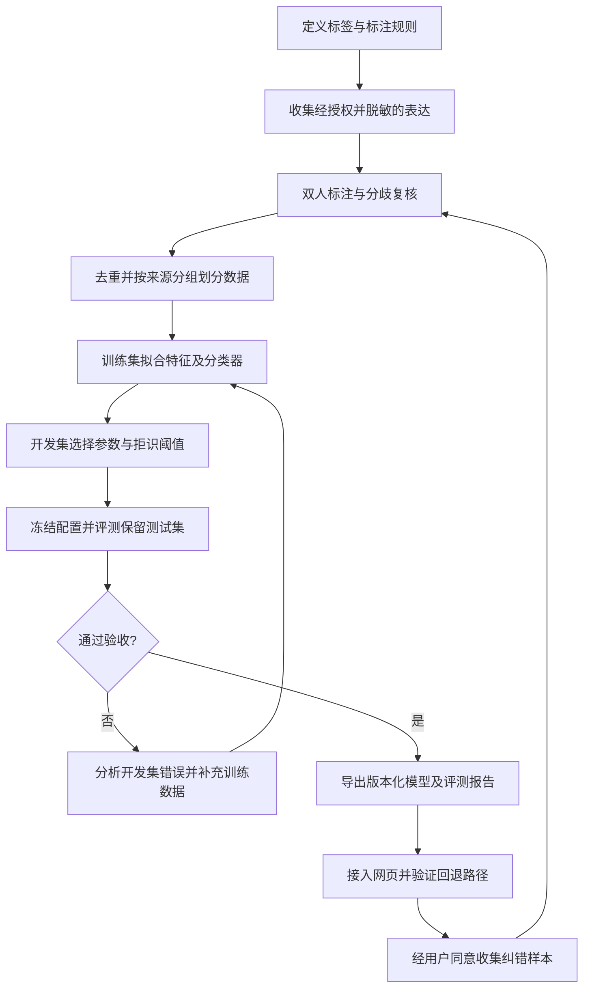

# 心铃项目本地 AI 训练流程

本文保留最初实施设计。现已按 JavaScript 路线完成第一版原型训练、导出和网页接入，实际实施与结果见 [training/README.md](training/README.md)。下文 Python 目录与 scikit-learn 参数属于原始方案；实际脚本为 Node.js 实现，模型超参数和评测以版本化产物为准。

## 1. 第一阶段目标与边界

训练一个中文困扰意图分类模型：输入一段用户表达，输出六类困扰之一或 `other`，供已有疏导话术库选择回应。模型学习用户表达与类别之间的关系；回复内容仍从人工审核的话术中组合。

第一阶段推荐字符级 TF-IDF + 逻辑回归，可在普通电脑 CPU 上训练。该模型属于真正的监督学习，但不是生成式大语言模型，也不输出临床诊断。无需先下载大模型或租用 GPU。

目前 `public/training-data.json` 是六类意图的话术配置，不是带标签的训练语料；`public/app.js` 的 `scoreTrainingIntent` / `findTrainingIntent` 使用关键词及画像匹配。`netlify-deploy/public/app.js` 主要实现问卷评估，与前者不是同一版本。应先在 `public/` 完成训练模型接入和核验，再明确同步到 Netlify 的功能范围。

## 2. 完整流程



若根据测试集错误调整了模型，该测试集就不再是独立最终评测依据；下一版需另备未见数据。

## 3. 标签体系

| 标签 ID | 含义 | 标注示例（人工编写） |
| --- | --- | --- |
| `exam_result_fear` | 考试结果担忧 | 我怕这次高数过不了 |
| `task_start_block` | 任务堆积或无法启动 | 资料摊了一桌，我还是不知道从哪开始 |
| `sleep_burnout` | 睡眠困扰与透支 | 连着几晚没睡好，白天脑子转不动 |
| `self_blame` | 自责与自我否定 | 一点小事都做不好，我觉得自己很差 |
| `future_uncertainty` | 升学就业与选择困扰 | 考研还是找工作，我一直拿不定主意 |
| `relationship_pressure` | 人际关系与外界期待 | 家里总拿我和别人比较，我很难受 |
| `other` | 闲聊、无明确困扰、范围外问题 | 今天食堂有什么好吃的 |

标注应依据用户实际求助重点，不按单个关键词决定。“我不担心考试，只是室友一直吵”应标为关系压力。多种困扰共存时记录主意图与次意图；主意图无法确定的样本进入复核，不强行归类。

另设独立字段 `risk_review`，取值 `none / needs_review / urgent`，供人工复核和风险路径验证使用，不作为七类意图之一。`none` 仅表示该文本未标出风险线索。第一阶段不训练临床风险判定器，风险标注规则及样本应由具备相关专业能力的人员参与复核。

## 4. 数据准备与格式

建议首轮目标为每类 150～300 条，共约 1,050～2,100 条；这是收集目标，不代表已经具备这些数据。先用每类 30～50 条跑通流程，再扩充。小样本结果只用于原型验证。

来源优先选择经明确授权的匿名表达、许可允许此用途的公开语料、人工编写的场景样本。真实对话须单独征得用于训练的同意，删除姓名、联系方式、学校班级等身份信息。不要默认读取浏览器历史或将用户聊天自动加入训练集。

合成样本记录来源与生成模板，经过人工审核；同一句话的所有改写归为同组，避免拆到训练集和测试集两边。独立测试集应包含真实或由独立人员编写的表达，不能只用训练模板的改写。

建议 JSONL 一行一条，以下仅为格式示例：

```json
{"id":"sample-0001","text":"复习资料太多，我坐下来就不知道先看什么","intent":"task_start_block","secondary_intents":[],"risk_review":"none","group_id":"scenario-0001","source":"human_written","training_allowed":true,"annotation_status":"reviewed"}
```

两人独立标注，分歧经讨论裁决；未完成复核、未获训练授权的样本不进入训练。记录标注指南版本、类别分布、分歧率与裁决结果。

按用户、会话、来源场景及改写关系形成分组；有相互关联的组需合并。先做规范化去重和近似重复排查，再以组为单位按约 70% / 15% / 15% 划分训练、开发、测试集，尽量保持类别分布。固定随机种子 42 并保存划分清单；组边界优先于精确比例。

## 5. 第一版模型训练

建议 Python + scikit-learn，通过 Pipeline 把特征提取和分类器绑定，避免数据泄漏。

| 环节 | 初始方案 |
| --- | --- |
| 文本预处理 | Unicode 规范化、折叠多余空白；保留否定词与有意义的标点 |
| 特征 | `TfidfVectorizer(analyzer="char", ngram_range=(1,3), min_df=2, max_features=30000, sublinear_tf=True)` |
| 分类器 | `LogisticRegression(C=1.0, class_weight="balanced", max_iter=1000)` |
| 候选参数 | 开发集比较 `C ∈ {0.5, 1, 2}`、字符 n-gram `(1,3)` 与 `(2,4)` |
| 选择依据 | 开发集 macro-F1，兼顾拒识效果和各类召回率 |
| 基线 | 当前关键词策略、训练集多数类预测 |

词表、IDF 和分类器只能在训练集拟合。参数、拒识阈值只在开发集选择。第一版仅以文本训练，后续单独比较加入画像是否有益，避免用户预选类别掩盖文本识别不足。

这类小模型新增数据后通常重新拟合全量训练集；不把它描述为从大模型检查点续训。每轮保存语料版本、划分、参数、依赖版本及产物，保证可复现。

## 6. 置信度与拒识

保存前两类概率及差值。概率只是分类器估计，不能解释为心理状态概率。

开发阶段可从最高概率 0.55、前两类差值 0.15 开始搜索拒识阈值；这些是待验证初值，不是已确认的可靠阈值。若分数低、两类接近、预测为 `other` 或输入为空，先澄清用户需求或返回通用支持，不强行套入某类困扰。

验证时同时报告接受预测的覆盖率及其准确率，避免仅通过大量拒识制造好看的指标。

## 7. 评测与验收

在相同保留测试集上比较关键词基线与训练模型；画像加权版和纯文本版分开报告。输出 macro-F1、各类 precision/recall/F1、样本数、混淆矩阵、拒识覆盖率，以及目标设备的加载耗时与单条推理耗时。

第一轮可将以下设为研发验收目标，实际是否达到必须实测：

- 七类 macro-F1 ≥ 0.80，且比纯文本关键词基线提升至少 0.05。
- 每类召回率 ≥ 0.70；`other` 及低置信度输入能进入澄清路径。
- 在固定范围外输入集上报告误接收率，并在开发集选择可接受的覆盖率与错误率折中。
- 风险回归样例全部进入预期的支持或人工复核路径；这仅是回归检查，不证明真实风险零漏判。
- 在实际电脑和浏览器验证推理时间、模型大小，以及无模型或加载失败时的回退行为。

另备人工审核样例覆盖否定、转述、隐喻、拼写错误、上下文指代、多意图与危机表达。不要把某个关键词出现与否直接当作风险真值。回复验收检查是否贴合诉求、是否过度断言、是否包含可执行行动，以及是否正确保留风险优先路径。

## 8. 网页接入方案

推荐先保留现有风险规则，在普通意图匹配前接入分类器：

```text
用户消息
  → 现有风险处理（必要时优先支持与求助提示）
  → 意图模型分类
  → 高置信度：按 intent ID 读取 training-data.json 的话术
  → 低置信度 / other：澄清或通用支持
  → 模型缺失 / 异常：回退现有关键词策略
```

本地 Node 服务可以先调用独立的 Python 推理服务验证效果；不要每条消息都重新启动 Python 或重新加载模型。纯静态 Netlify 网页不能直接运行 Python，建议第二步导出字符词表、IDF、类别顺序、逻辑回归权重及预处理配置为 JSON，在 JavaScript 中实现相同计算。

导出时需明确 scikit-learn 的字符切片与空白处理、TF-IDF 平滑公式及 L2 归一化、截距、类别顺序和多分类 softmax。用同一批固定输入比较 Python 与 JavaScript 的概率误差与最终标签，通过后再发布。不能只复制模型文件就宣称静态页面已接入。

风险规则保留优先权，意图模型不得将风险提示降级。问卷评分继续使用现有公式，除非以后另有经过验证的训练目标。

## 9. 建议文件与实施顺序

以下是待创建的目录和命令约定，当前尚不可直接运行：

```text
training/
  README.md                 环境、流程和复现命令
  label-guide.md            标签定义与边界案例
  data/                     经授权的语料及固定划分，不随静态站点发布
  prepare.py                格式检查、授权过滤、去重和分组划分
  train.py                  训练及开发集参数选择
  evaluate.py               保留测试集评测和基线比较
  export.py                 导出浏览器推理参数
  artifacts/<version>/      模型、配置、划分指纹及指标
public/
  intent-model.js            浏览器特征提取与推理
  models/intent-model.json   可发布的模型参数
```

| 顺序 | 工作 | 完成依据 |
| --- | --- | --- |
| 1 | 确认七类标签、编写标注指南与少量人工样例 | 标注人员能一致使用标签 |
| 2 | 建立数据检查、分组划分、训练和评测脚本 | 小样本可跑通，拒绝无效标签和跨集合重复 |
| 3 | 收集并复核首轮语料 | 各类覆盖充分，授权和来源可追溯 |
| 4 | 训练基线、调参并冻结配置 | 开发集记录完整，测试集未参与调参 |
| 5 | 正式评测并导出模型 | 有真实指标、失败案例及版本记录 |
| 6 | 接入 `public/`，验证后同步 Netlify 版本 | Python/JS 一致性、风险优先与回退验证通过 |

后续每轮只将经同意、脱敏、复核的纠错样本加入新版本训练集；保留旧模型用于回滚。第一阶段稳定后，可在相同独立评测条件下比较中文编码器微调；是否训练生成式对话模型再依据回复数据质量、硬件和实际收益决定。
